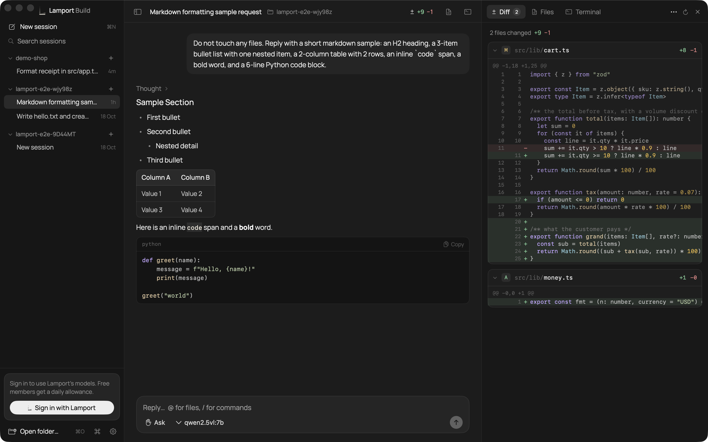
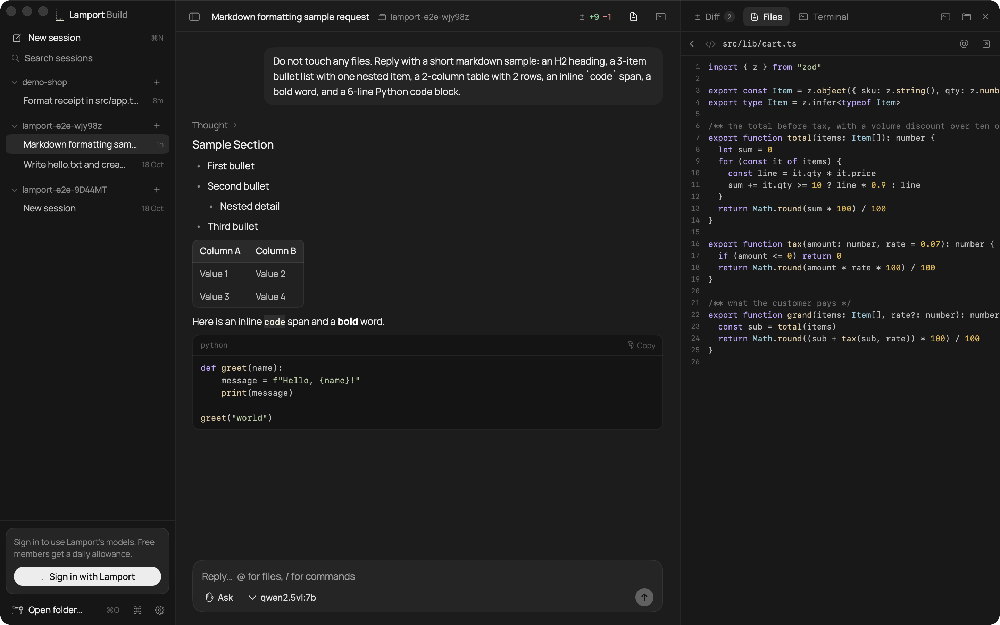

# lamport build

A coding agent for the Mac. Open a folder, say what you want, and it reads, edits and runs the code
there. Edits and commands wait for your OK, the diff updates as it works, and a real shell sits next to it.



Native SwiftUI, no web view. Sessions on the left, the conversation in the middle, diff, files and
terminal on the right. Models run through lamport.si with your own sign-in; no provider keys are
stored on the Mac. Models served on the Mac itself (Ollama, LM Studio) show up in the picker too.

## install

```
curl -fsSL https://lamport.si/install | bash
```

Apple silicon, macOS 14+. The script reads the release feed, checks the app is signed by Lamport
Robotics, puts it in /Applications and opens it; updates arrive inside the app. `INSTALL_DIR` and
`NO_OPEN=1` are honoured. The dmg is at https://lamport.si/mac/ if you prefer to drag.

## what it does

- **Approvals.** Every edit and every command is a card with Allow, Always allow and Deny. Four
  permission modes, the same as the Claude Code desktop: ask before edits, edit automatically,
  plan, bypass.
- **Diff.** Each file the agent touched, with line numbers and colour, as it works. Open a file
  from the panel or put it back the way git has it.
- **Files.** The folder's tree and a read-only view of any file, coloured by language.
- **Terminal.** A real shell in the folder, kept alive while you switch sessions.
- **Composer.** `@` mentions a file, `/` runs one of the engine's commands, a dropped file is
  mentioned. Answers render tables, lists, links and coloured code.
- **⌘K.** A palette for sessions, models, permissions, panels and commands. `⌘/` lists every
  shortcut.
- **Sessions.** Per folder, searchable by content, with fork and compact.



## build

```
brew install xcodegen
xcodegen generate
open LamportBuild.xcodeproj
```

macOS 14+, Apple silicon. `scripts/release.sh` makes a signed zip and dmg and, with the Sparkle
tools, the update feed.

The coding engine is built separately and goes in `engine/` (`lamport-engine` + `engine.json`); it is not
in this repo. Without it the app opens but can't run sessions.

For development the app takes `--folder <path>`, `--session <id>`, `--side diff|files|terminal`,
`--prompt "<text>"`, `--api <url>` and `--engine <dir>`.

The engine is a rebranded build of an MIT-licensed open-source coding agent. Its license and the licenses
of everything bundled with it are in `Resources/THIRD_PARTY_NOTICES`. The Manrope face is bundled under the
SIL Open Font License.

## license

MIT
